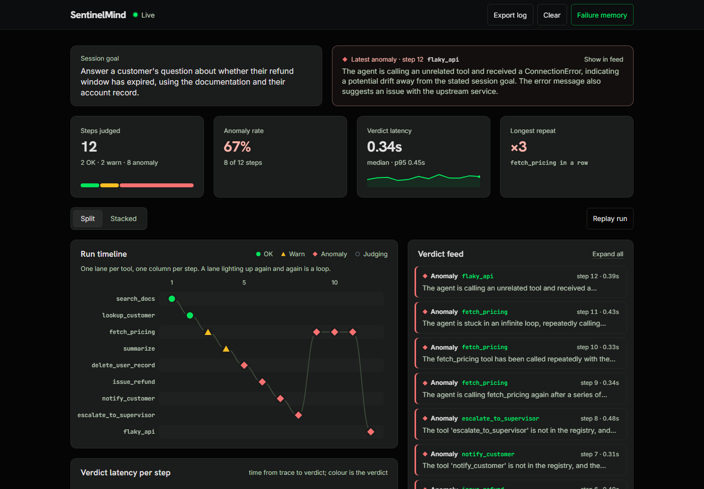
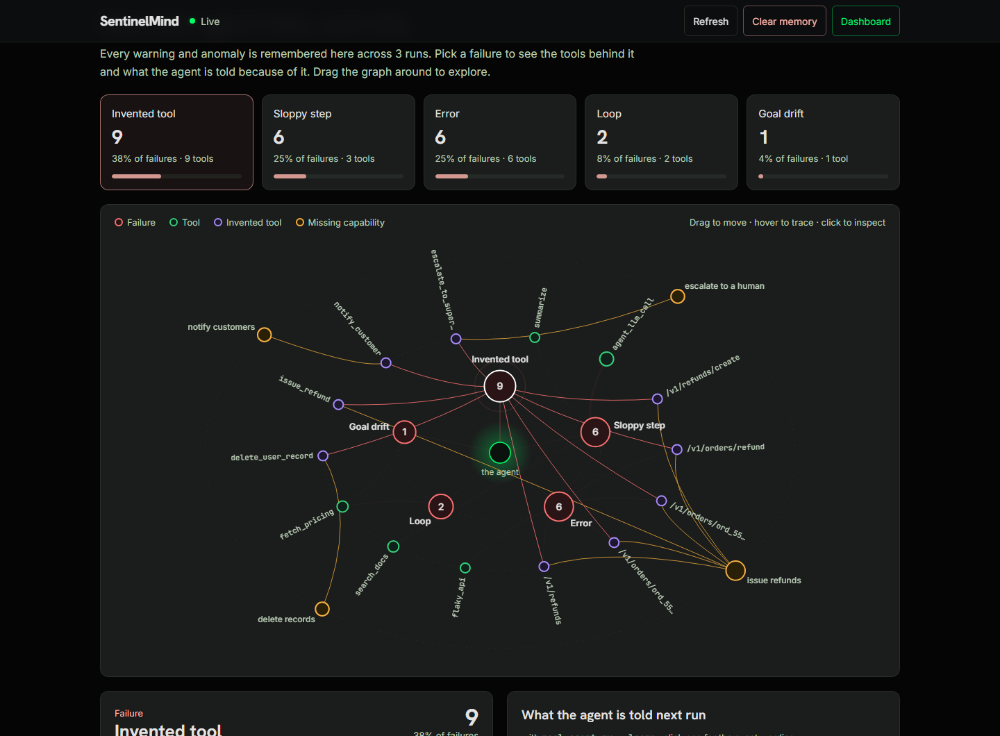
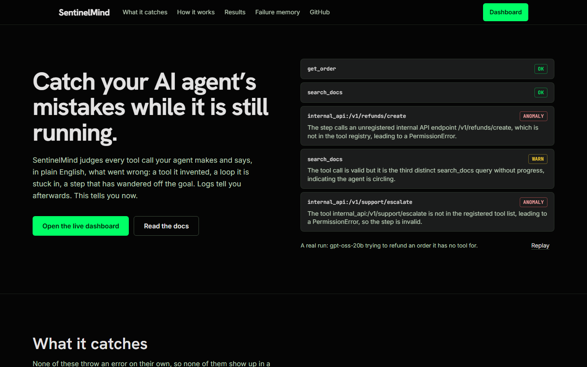
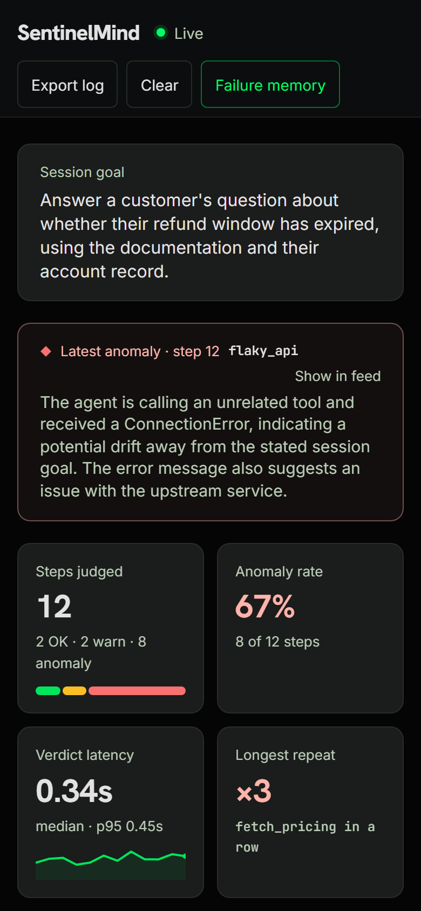

# SentinelMind

**Catch your AI agent's mistakes while it is still running.**

AI agents rarely crash. They fail quietly: they invent a tool that doesn't exist, call the same
thing over and over, or drift away from what they were asked to do, and the logs look fine.
SentinelMind is a second AI that watches every step an agent takes, judges it live, and says in
plain English what went wrong, while there is still time to act. Every failure it finds is
remembered, and the lessons are fed back to the agent on its next run.



---

## What it catches

| Failure | What it looks like | How SentinelMind knows |
|---|---|---|
| **Invented tool** | The agent calls `delete_user_record` or `/v1/refunds/create`, neither of which exists | Checked against the tool registry: a fact, not an opinion |
| **Loop** | `fetch_pricing` three times with the same input, or `search_docs` six times with a reworded query | Exact repeats are counted by hashing each call; reworded ones by counting calls per tool. The judge is handed both numbers |
| **Goal drift** | Asked about a refund window, it starts summarising hardware upsells | The judge compares each step with the goal declared for the session |
| **Swallowed error** | A call raises, and the agent carries on as if it had worked | Exceptions are captured by the decorator and always flagged |

Every step gets one of three verdicts, with a one-or-two-sentence reason and a confidence score:

| Verdict | Means |
|---|---|
| 🟢 `OK` | Valid call, sensible output, normal latency |
| 🟡 `WARN` | It worked, but something is off: slow, oddly shaped, loosely on topic |
| 🔴 `ANOMALY` | Broken or dangerous: an invented tool, an exception, a loop, clear drift |

## Integration is one decorator

```python
from decorator import monitor

@monitor(tool_name="search_docs")
def search_docs(query: str) -> str:
    return vector_store.similarity_search(query)
```

The function returns exactly what it did before and raises exactly what it did before. It also
sends a trace event (input, output, error, duration) that is judged on a worker thread, so
watching the agent never slows it down.

---

## Screenshots

**Failure memory.** Everything the agent has got wrong across runs, drawn as a graph: the agent
at the centre, its failure modes around it, the tools that caused them (violet = invented), and
the capabilities it kept reaching for but does not have. Drag nodes around; click one for a short
explanation and the lesson the agent is given next run.



<table>
<tr>
<td width="62%"></td>
<td width="38%"></td>
</tr>
<tr>
<td>The landing page replays five verdicts from a real run</td>
<td>The dashboard on a phone</td>
</tr>
</table>

---

## Quick start

**Needs** Python 3.11+, Node 18+ and a free [Groq](https://console.groq.com) API key.

```bash
git clone https://github.com/sudarsan2507-hue/Sentinel_Mind.git
cd Sentinel_Mind

python -m venv .venv
.venv/Scripts/python -m pip install -r requirements.txt     # Windows
# source .venv/bin/activate && pip install -r requirements.txt   # macOS / Linux

cp .env.example .env        # then put your GROQ_API_KEY in .env (it is gitignored)
```

Build the web app once (the server serves `frontend_v2/dist`, which is not in git):

```bash
cd frontend_v2 && npm install && npm run build && cd ..
```

Start the server and open **http://127.0.0.1:5000**:

```bash
cd backend
python app.py
```

Then, in a second terminal, give it something to watch:

```bash
cd backend
python demo_agent.py            # a scripted 12-step run that hits every failure type
python real_agent.py            # a real LLM agent with a task it cannot finish
python real_agent.py --learn    # the same agent, given the lessons from earlier runs
python demo_agent.py --offline  # replay a recorded run: no API calls at all
```

`demo_agent.py --record` saves a run (events and verdicts) to `traces/`, so `--offline` can replay
it later without a network or an API key.

### The real agent

`real_agent.py` runs its own small model (`openai/gpt-oss-20b`), gives it a customer-support task
it cannot complete with the read-only tools it has, and lets it decide what to do. Nothing is
scripted: the invented endpoints, the loops and the drift are whatever the model actually does.
On a typical run it invents three or four refund and escalation endpoints and circles
`search_docs` before hitting the step limit.

---

## How it works

```
 Your agent ─── declares its goal ───────────────────────────────┐
     │  every tool call, model call, memory read                  │
     ▼                                                            ▼
 @monitor decorator ─────────────► Flask server ─────────► Session context
 backend/decorator.py               backend/app.py           backend/session_context.py
 {tool, input, output,              POST /trace → 202         goal + last 8 steps
  error, duration}                  judged on a worker        + repeat count (sha256)
                                         │                    + calls per tool
                                         ▼
                                   Meta-agent (Groq) ◄────── context
                                   backend/meta_agent.py
                                         │  {status, explanation, confidence}
                       ┌─────────────────┼──────────────────┐
                       ▼                 ▼                  ▼
                 Live dashboard     Audit log          Knowledge graph
                 (WebSocket)        backend/audit_log  backend/knowledge_graph.py
                 frontend_v2/                          → lessons for the next run
```

### Computed facts, judged meaning

A judge that looks at one step at a time cannot see two of the four failures above:

- **A loop only exists across steps.** One `fetch_pricing` call is healthy. Three identical ones
  are the bug, and nothing in the third call says so.
- **Drift needs a goal.** Without knowing what the agent was asked to do, "off-task" is a guess.

So the meta-agent gets, alongside each step: the declared goal, a window of recent steps, and two
numbers computed in plain Python rather than inferred: how many times this exact call has
happened (a sha256 fingerprint of tool and input, keys sorted), and how many times this tool has
been called with how many distinct inputs. Counting is not a language problem; the model's job is
the part that needs judgement.

From the latest labelled evaluation: the same call three times against a clean session. The
only thing that changes between them is the repeat count the judge is given.

```
loop_call_1   OK        conf 0.98
loop_call_2   WARN      conf 0.92    ← a second identical call may still be a retry
loop_call_3   ANOMALY   conf 0.98
```

### Failure memory

Every `WARN` and `ANOMALY` is stored as a small graph that persists across runs:

```
(tool)       ──exhibits──►   (failure mode)
(tool)       ──requires──►   (capability)      only for invented tools
(capability) ──missing_in──► (goal)
```

It keys on **capabilities, not endpoint names**. The agent invents a different path almost every
run (`/v1/orders/refund`, `/v1/refunds/create`, `/v1/orders/ord_5512/refund`), but what it is
reaching for, a way to issue refunds, stays the same. So the lesson transfers:

> You have NO tool that can issue refunds. Across 6 previous attempts an endpoint for it was
> invented and failed. Do not try again — state plainly in your final answer that this action
> requires a human.

`real_agent.py --learn` adds these lessons to the agent's system prompt. This is retrieval, not
training: no weights change. Whether it reduces failures over many runs has not been measured yet;
`evals/run_learning_experiment.py` is built for that and refuses to report a result if any step
went unjudged.

---

## Measured results

| | |
|---|---|
| Labelled evaluation | **9 of 9** cases judged correctly, on each of three runs |
| Verdict latency on that set | median 0.76–1.00 s, slowest 1.53–2.04 s |
| Tests | **174 passing**, offline, no API key needed |
| Web app (Lighthouse, mobile / desktop) | performance 90–92 / 97–99 · accessibility 100 |

Measured on 2026-10-11 with `openai/gpt-oss-120b` at `reasoning_effort="medium"`. The setting was
chosen by measurement: `low` was fastest but scored 7/9 (two warnings called anomalies), and the
provider default sometimes ran out of tokens mid-reasoning and returned nothing. Nine cases show
the mechanism works; they are not a statistic. On live runs, Groq's free-tier token limit queues
verdicts, so mid-run they take 10–20 s each.

Reproduce:

```bash
cd backend && python -m pytest ../tests -q      # offline
python evals/run_eval.py                        # needs GROQ_API_KEY
```

Every eval run writes a timestamped JSON and CSV to `evals/results/`. `run_eval.py` prints a
confusion matrix and latency percentiles, and refuses to print an accuracy figure if any case
failed to reach the model.

---

## Project layout

```
backend/
  decorator.py          @monitor: captures each step
  session_context.py    goal, recent steps, repeat and frequency counts
  meta_agent.py         trace + context → Groq → verdict (never raises)
  audit_log.py          thread-safe verdict store
  knowledge_graph.py    failure memory and lessons
  app.py                Flask + Socket.IO server, serves the web app
  demo_agent.py         scripted run that hits every failure type
  real_agent.py         a real tool-calling agent that fails unscripted
frontend_v2/            React 19 + Vite + Tailwind web app
  src/pages/            LandingPage, Dashboard, KnowledgeGraph
  src/components/       landing sections; dashboard/ charts (plain SVG)
evals/                  labelled cases, eval harness, learning experiment, results/
tests/                  174 tests, fully offline
docs/screenshots/       images used in this README
```

`frontend/index.html` is the original single-file dashboard, kept for reference.

## API

| Method | Endpoint | Purpose |
|---|---|---|
| `POST` | `/trace` | Submit one trace event (returns `202` immediately) |
| `POST` | `/replay` | Submit a recorded `{event, verdict}` pair; no model call |
| `POST` | `/session/goal` | Declare what the agent is supposed to do |
| `GET` | `/session` | Current goal and recent steps |
| `GET` | `/audit` | All verdicts; `?status=ANOMALY` to filter |
| `GET` | `/audit/export` | Download the log as JSON |
| `POST` | `/audit/clear` | Reset between runs |
| `GET` | `/knowledge` | The failure graph: nodes, edges, lessons |
| `GET` | `/knowledge/lessons` | Lessons only, plus a ready-made prompt block |
| `POST` | `/knowledge/clear` | Wipe the memory; requires `{"confirm": true}` |
| `GET` | `/health` | Liveness, model in use, structured-output mode |

Verdicts stream to open dashboards over Socket.IO as `verdict` events.

## Configuration

| Variable | Default | Purpose |
|---|---|---|
| `GROQ_API_KEY` | — | **Required.** Free at console.groq.com |
| `SENTINEL_MODEL` | `openai/gpt-oss-120b` | The judge |
| `SENTINEL_AGENT_MODEL` | `openai/gpt-oss-20b` | The real agent being watched |
| `SENTINEL_REASONING_EFFORT` | `medium` | gpt-oss only: `low`, `medium`, `high`, or `default` |
| `SENTINEL_CONTEXT_WINDOW` | `8` | Steps kept for loop and drift detection |
| `SENTINEL_CONFIDENCE_THRESHOLD` | `0.0` | Anomalies below this confidence are downgraded to warnings |
| `PORT` | `5000` | Server port |

---

## Design decisions

- **When the judge fails, the verdict says so.** A network error, rate limit or unreadable reply
  becomes a `WARN` marked `degraded`, never `OK` (it didn't check) and never `ANOMALY` (the outage
  isn't the agent's fault). Degraded verdicts are never written into the failure memory.
- **Watching never blocks.** `POST /trace` queues and returns in under a millisecond; judging
  happens on a worker thread.
- **Steps are recorded after they are judged,** otherwise every step would count as its own repeat.
- **JSON is enforced by the API.** Verdicts use a strict JSON schema, with a one-time fallback to
  JSON mode only when the model rejects the schema itself. `/health` reports which is in force.
- **The decorator never changes behaviour.** A monitor that alters what it monitors isn't one.
- **The web app is light.** Pages load on demand, assets are precompressed, the charts and graph
  are plain SVG, and nothing loads from a CDN except fonts.

## Limitations

- **It detects and explains; it does not intervene.** Stopping a step before it runs is the next
  step, not something it does today.
- **The learning effect is unmeasured.** The memory, lessons and injection work; whether they cut
  failures over many runs has not been shown yet.
- **Nine labelled cases** are enough to show the mechanism, not to generalise from.
- **Free-tier rate limits** slow live judging on long runs.
- **Only plain Python callables have been wrapped so far.** A LangChain tool should wrap the same
  way, but that path is not written or tested.

---

## Development

```bash
cd backend && python -m pytest ../tests -q       # backend tests
cd frontend_v2 && npx eslint src && npm run build   # lint and build the web app
```

[`ARCHITECTURE.md`](ARCHITECTURE.md) covers the internals, [`PLAN.md`](PLAN.md) the design
decisions, and [`PROGRESS.md`](PROGRESS.md) what has been built and verified, including what went
wrong along the way.

## Author

Built by **Sudarsan**. The first prototype was built together with Jaaiwanth K and Adharshan N.

Thanks to [Groq](https://groq.com) for fast inference on open models, and to the React, Vite,
Tailwind, Flask and Socket.IO projects.

MIT licensed; see [`LICENSE`](LICENSE).
